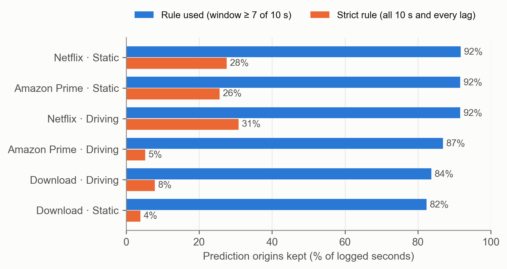
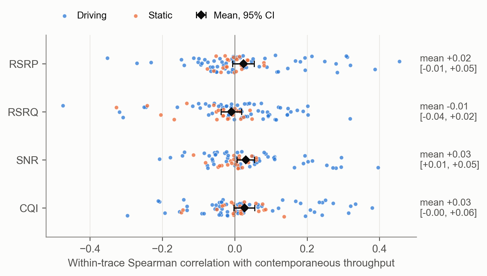
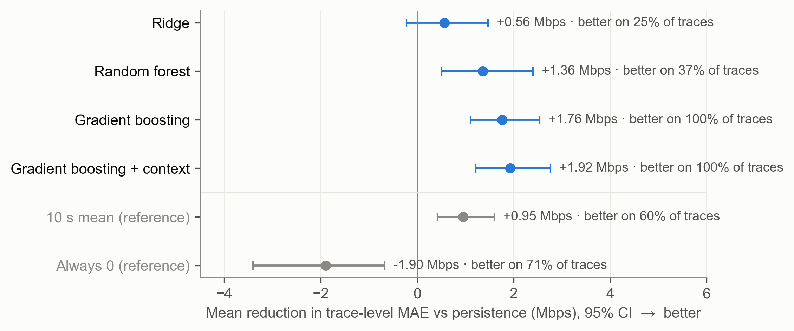
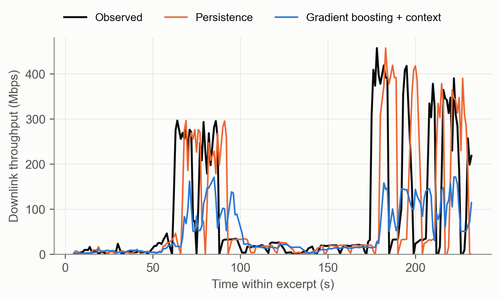
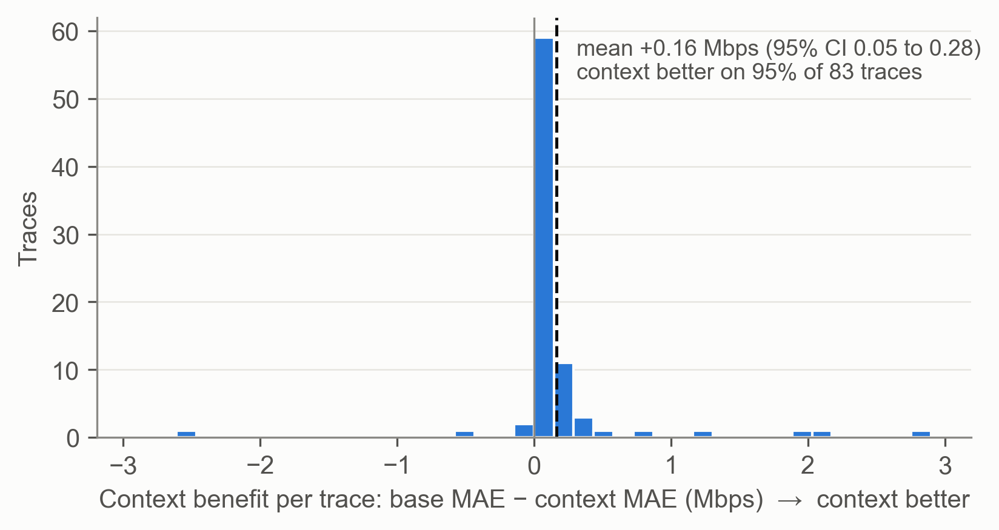
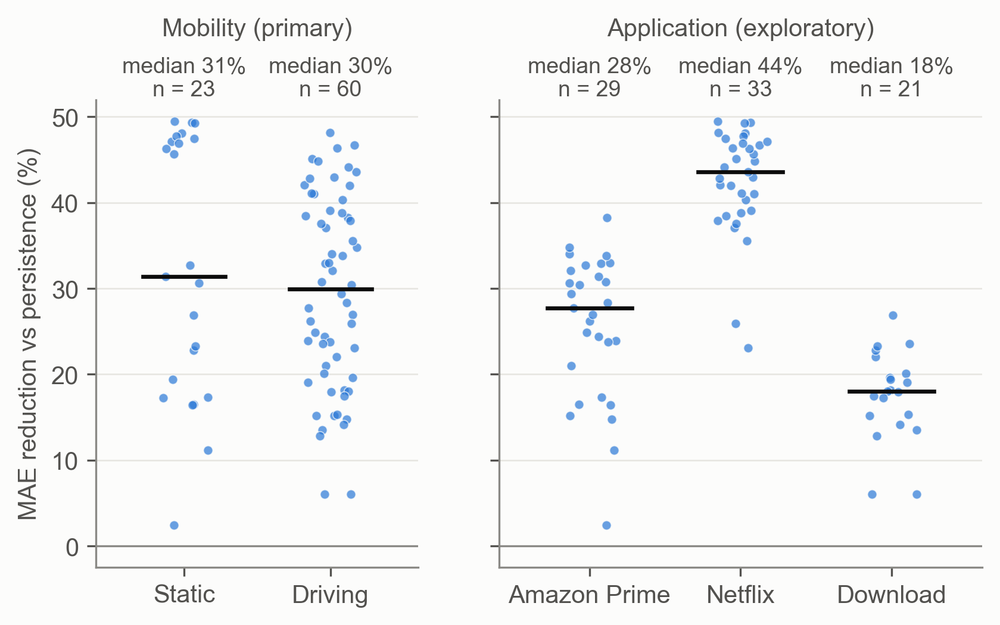
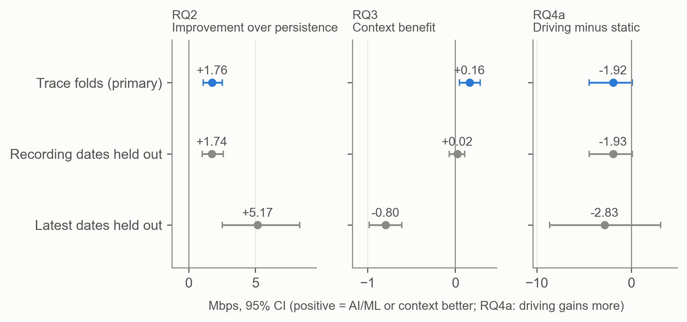

# Figure captions (APA 7 style)

Figure numbers follow the order of first mention in the Results chapter and continue after Figure 1 of the
synopsis (repository structure). File names keep the script's own order. Every figure is generated by
`python make_figures.py`; the numbers behind each one are in `outputs/tables/` (the table view for readers who
cannot use the colours).

| Report figure | File | Section |
|---|---|---|
| Figure 2 | fig5_coverage_rules.png | 8.0 |
| Figure 3 | fig1_rq1_correlations.png | 8.1 |
| Figure 4 | fig2_rq2_improvement.png | 8.2 |
| Figure 5 | fig6_example_trace.png | 8.2 |
| Figure 6 | fig3_rq3_context_benefit.png | 8.3 |
| Figure 7 | fig4_rq4_groups.png | 8.4 |
| Figure 8 | fig7_sensitivity.png | 8.5 |

---

**Figure 2**

*Prediction Origins Retained Under Two Eligibility Rules*

*Note.* Share of logged seconds usable as prediction origins. Both rules require the exact 5 s-ahead target and
current throughput. The strict rule also requires all ten seconds of history and every lagged value; the rule
used requires at least seven of the ten seconds, with missing lags imputed inside training folds. About 10% of
seconds are missing from the logs, so the strict rule would remove most observations unevenly across groups.

---

**Figure 3**

*Within-Trace Correlation Between Radio Measurements and Downlink Throughput (RQ1)*

*Note.* Each dot is one trace's Spearman correlation between the measurement and contemporaneous throughput
(blue = driving, orange = static). Diamonds show the mean across traces with a 95% t-interval. Traces need at
least 30 complete pairs and variation in both variables (82–83 eligible per measurement). No mean differs from
zero after Holm adjustment across the four measurements.

---

**Figure 4**

*Reduction in Prediction Error Relative to Persistence, by Model (RQ2)*

*Note.* Points show the mean across 83 held-out traces of persistence MAE minus model MAE for the 5 s-ahead
throughput target; bars are approximate 95% bootstrap intervals over traces, conditional on the fitted models.
Positive values mean lower error than persistence. Grey rows are reference baselines added after the primary
results were seen: "always 0" predicts no throughput, "10 s mean" predicts the mean of the preceding 10 s.
Percentages give the share of traces on which each predictor beats persistence.

---

**Figure 5**

*Observed and Predicted Throughput on a Held-Out Driving Download Trace*

*Note.* A 180 s excerpt chosen as the most variable stretch among held-out driving download traces; values are
plotted at the time being predicted (5 s after the prediction origin). Persistence repeats the value from 5 s
earlier, so it lags every change. The model, trained to minimise absolute error, predicts values between the
burst and idle levels: it reduces average error but underestimates peaks.

---

**Figure 6**

*Per-Trace Benefit of Adding Context Features (RQ3)*

*Note.* Each trace's MAE with the base features (radio measurements and throughput history) minus its MAE after
adding speed, network mode and application type, using the same algorithm family, folds and tuning budget.
The dashed line marks the mean; the interval is an approximate 95% bootstrap interval over traces. Primary
evaluation only; the benefit did not hold in the sensitivity analyses (Figure 8).

---

**Figure 7**

*Relative Error Reduction Over Persistence by Mobility and Application (RQ4)*

*Note.* Each dot is one trace's MAE reduction relative to persistence, as a percentage of its persistence MAE,
for gradient boosting with context features. Horizontal lines mark group medians. Relative values are shown
because absolute errors differ greatly by application (download throughput is about 20 times video
throughput). The mobility comparison is primary; the application comparison is exploratory.

---

**Figure 8**

*Key Results Under Three Evaluation Schemes*

*Note.* Each row repeats the full nested procedure with retraining: trace folds (primary, 83 traces), all traces
from a recording date held out together (83 traces), and the latest 5 of 27 recording dates held out (17
traces). Points are means with approximate 95% bootstrap intervals over traces. The RQ2 improvement stays
above zero in every scheme; the RQ3 context benefit vanishes and then reverses; RQ4a stays inconclusive. The
chronological test set holds 14 download, 3 Amazon Prime and no Netflix traces, so its absolute values are not
comparable with the other rows.
